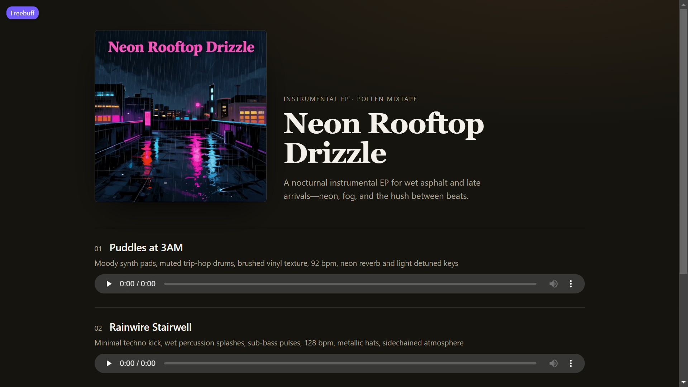

# Pollen Mixtape

One line of mood in, a release plan out — and an instrumental EP when you ask for the audio: cover art,
liner notes, a per-track music prompt and a card you can open and play, all generated through the
[Pollinations](https://pollinations.ai) models with the [polli CLI](https://www.npmjs.com/package/@pollinations/cli).

This repository is an **agent skill** in the [Agent Skills](https://agentskills.io/) format. Point a
coding agent at it and it knows how to make a mixtape; there is no API key to handle because the CLI
signs the agent in.

```bash
npm i -g @pollinations/cli
polli auth login

git clone https://github.com/rekty/pollen-mixtape
cd pollen-mixtape
node scripts/mixtape.mjs --idea "rainy rooftop at 3am, neon reflections in puddles"
open out/index.html
```



## Free by default, audio on request

A plain run uses free models only: the text model writes the EP and the cover model draws it. Every
music model on Pollinations is `paid_only`, so rendering the tracks is an explicit opt-in — pass
`--music elevenlabs/music-v2.5` when the release should come with audio:

```bash
# full release, including three instrumental loops (paid audio)
node scripts/mixtape.mjs --idea "rainy rooftop at 3am" --music elevenlabs/music-v2.5
```

Nothing is spent on music unless that flag is there, and the card says so when it is missing.

## What it makes

```text
out/
  cover.png       1024x1024 cover art
  index.html      release card: cover, liner notes, per-track prompts (+ players when rendered)
  track-1.mp3     instrumental loop (only with --music)
  track-2.mp3
  track-3.mp3
  release.json    title, liner note, the prompt used per track, audio model
```

The card is a plain local file: no hosting, no uploads, plays offline.

## Flags

| flag | default | meaning |
|---|---|---|
| `--idea` | required | the mood, scene or one-liner |
| `--out` | `./out` | output directory |
| `--tracks` | `3` | 1–6 tracks |
| `--duration` | `12` | seconds per loop (used when rendering audio) |
| `--music` | off | paid music model to render the tracks with, e.g. `elevenlabs/music-v2.5` |
| `--seed` | random | same idea + same seed = same cover and titles |

## Models

| step | model | note |
|---|---|---|
| text | Pollinations default text model, JSON mode | EP title, liner note, one music prompt per track |
| image | `zimage` (`tongyi-mai/z-image-turbo`) | $0.004 per cover, not `paid_only` |
| audio | `elevenlabs/music-v2.5`, instrumental, only with `--music` | `paid_only: true` — the bulk of the cost |

The example release in `examples/rainy-rooftop` cost about $0.10 in total, audio included.

## Notes

- Audio is generated from prompts only; nothing is sampled from existing recordings.
- `elevenlabs/music-v2.5` refuses a seed together with a prompt, so tracks are unseeded on purpose.
- Every file is written by polli's own `--output`, so a failed call leaves no half-written audio.

## Skill file

`SKILL.md` is the part the agent reads: when to use the skill, how to run it, and what to do with the
result. Keep the two in sync when changing the script.

---

[](https://pollinations.ai/?ref=badge)
