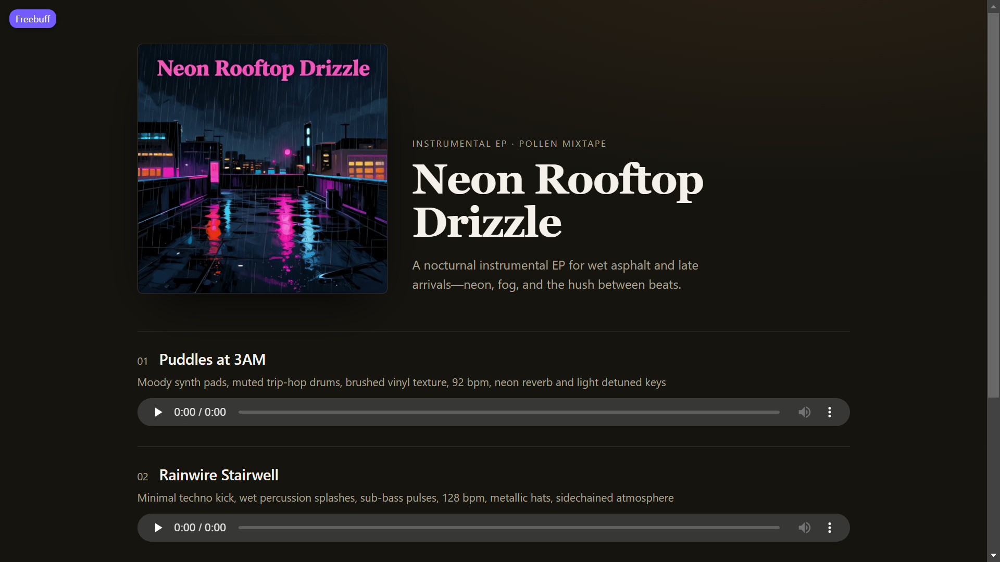

### App Name

Pollen Mixtape

### App Description

Turn one line of mood into an EP: cover art, liner notes, a prompt per track and a playable card, free with the polli CLI; audio renders only when you opt into a paid music model.

### App URL


### GitHub Repository URL

https://github.com/rekty/pollen-mixtape

### App Category

video_audio

### Platform

library

### App Language

en

### Screenshot



### Quest

#20020

### Default models

The skill's default run no longer uses a paid-only model. It stays on models that are free for users: the default Pollinations text model for the JSON release plan and `zimage` (`tongyi-mai/z-image-turbo`, not `paid_only`) for the cover art.

Every music model in the catalog is `paid_only: true`, so audio is now strictly opt-in. A plain run writes `cover.png`, `index.html` and `release.json` with one music prompt per track, and the release card states that rendering the loops is a separate paid step. Tracks are generated only when the caller passes an explicit flag:

```bash
node scripts/mixtape.mjs --idea "rainy rooftop at 3am" --music elevenlabs/music-v2.5
```

`README.md` and `SKILL.md` both document that step as paid, tell the agent to mention the cost before spending, and the skill description no longer promises audio by default: https://github.com/rekty/pollen-mixtape
